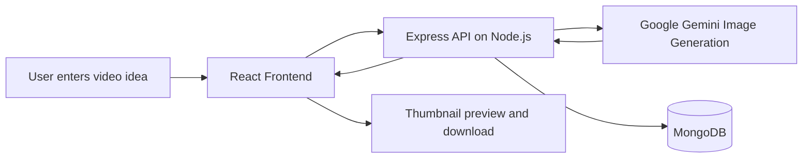
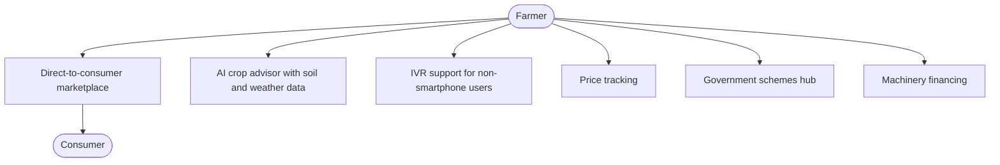
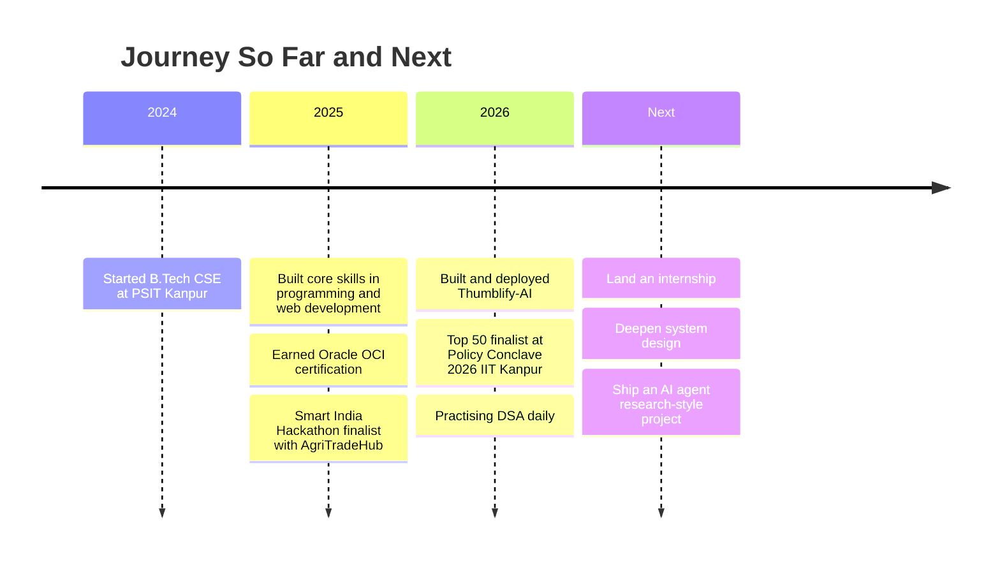

<!-- ================= HEADER ================= -->

 

<!-- Boxy link panel: replace every YOUR-... placeholder -->
<table>
  <tr>
    <td align="center"></td>
    <td align="center"></td>
    <td align="center"></td>
  </tr>
  <tr>
    <td align="center"></td>
    <td align="center"></td>
    <td align="center"></td>
  </tr>
</table>

 

I am a third-year Computer Science student who turns ideas into working products: full-stack web apps, LLM-powered tools, and clean solutions to hard problems. I like projects that real people can open, use, and benefit from, which is why every project below has a live link.

<b>[ + ] quick_facts.log</b>

 

| Field | Value |
|:--|:--|
| 🎓 **Studying** | Computer Science & Engineering, 3rd year |
| 📍 **Base** | Kanpur, Uttar Pradesh, India |
| 🌱 **Learning** | System design, LLM-powered applications |
| 💬 **Ask me about** | React, Node.js, FastAPI, Gemini API, LeetCode patterns |
| ⚡ **Seeking** | Internships in software development and AI/ML |

---

tech_stack

<table>
  <tr>
    <td align="center" width="170"><b>Languages</b></td>
    <td></td>
  </tr>
  <tr>
    <td align="center"><b>Frontend</b></td>
    <td></td>
  </tr>
  <tr>
    <td align="center"><b>Backend</b></td>
    <td></td>
  </tr>
  <tr>
    <td align="center"><b>Database</b></td>
    <td></td>
  </tr>
  <tr>
    <td align="center"><b>AI &amp; Data</b></td>
    <td>
      
      
      
      
    </td>
  </tr>
  <tr>
    <td align="center"><b>Deploy &amp; Tools</b></td>
    <td></td>
  </tr>
</table>

---

projects --featured

<table width="100%">
  <tr>
    <td>
      <h3>AgriTradeHub <code>SIH FINALIST</code></h3>
      <i>Full-stack agricultural platform connecting farmers directly to consumers</i>
        
      
        
      <ul align="left">
        <li>Direct-to-consumer marketplace helping farmers earn <b>15-20% better prices</b> than mandi rates</li>
        <li><b>AI crop advisor</b> with real-time soil and weather monitoring</li>
        <li><b>IVR support</b> so non-smartphone users can access the platform too</li>
        <li>Price tracking, a government schemes hub, and machinery financing for <b>50,000+ farmers</b></li>
        <li>Selected as a <b>Smart India Hackathon finalist</b></li>
      </ul>
    </td>
  </tr>
  <tr>
    <td>
      <h3> Thumblify-AI <code>MERN + GEMINI</code></h3>
      <i>AI thumbnail generator that turns a video idea into a ready-to-use YouTube thumbnail</i>
        
      
      
        
      <ul align="left">
        <li>Full-stack web app (MongoDB, Express, React, Node.js) that generates custom thumbnails from text prompts using Google Gemini</li>
        <li>Designed the prompt pipeline and React UI to turn a product idea into a usable AI tool</li>
        <li>Deployed on Vercel with iterative testing and feedback to refine output quality</li>
      </ul>
    </td>
  </tr>
  <tr>
    <td>
      <h3>🧩 LeetCode Practice <code>JAVA + DSA</code></h3>
      <i>Clean, readable solutions to LeetCode problems, grouped by pattern</i>
        
      
    </td>
  </tr>
</table>

<b>[ - ] thumblify_architecture.mmd</b>

 

<b>[ + ] agritradehub_features.mmd</b>

 

---

certifications

---

 git journey

---

stats

 

 

 

<picture>
  <source media="(prefers-color-scheme: dark)" srcset="https://raw.githubusercontent.com/ayush91dubey/ayush91dubey/output/github-snake-dark.svg" />
  <source media="(prefers-color-scheme: light)" srcset="https://raw.githubusercontent.com/ayush91dubey/ayush91dubey/output/github-snake.svg" />
  
</picture>

---

| Goal | Focus area |
|:--|:--|
| 🏗️ **Build** | Full-stack products with clean code, live deployments and good documentation |
| 🧮 **Practise** | DSA and problem-solving through consistent daily practice |
| 🤖 **Explore** | Applied AI: RAG pipelines, LLM tools and agent-based systems |
| 🏆 **Compete** | Hackathons and open challenges |

---

connect 

I am open to internships, collaborations, and hackathon teams. If you are hiring or building something interesting, send a packet my way.

<table>
  <tr>
    <td align="center"></td>
    <td align="center"></td>
    <td align="center"></td>
    <td align="center"></td>
    <td align="center"></td>
  </tr>
</table>

