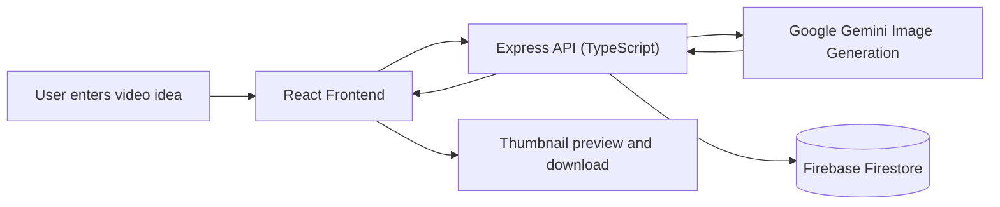
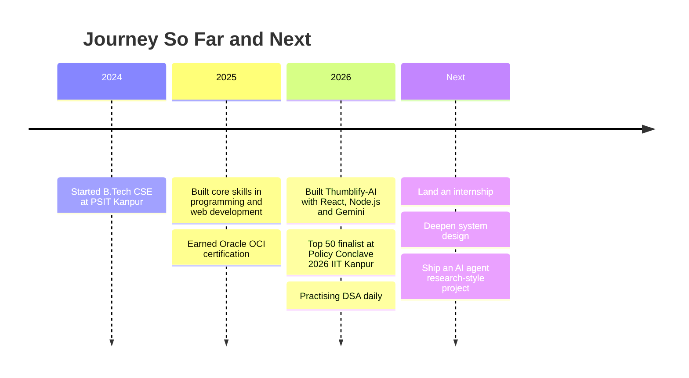

<!-- ================= HEADER ================= -->
<div align="center">


<a href="https://github.com/ayush91dubey">
  
</a>

<br/>

<!-- Boxy link panel: replace every YOUR-... placeholder -->
<table>
  <tr>
    <td align="center"><a href="https://github.com/ayush91dubey"></a></td>
    <td align="center"><a href="https://www.linkedin.com/in/YOUR-LINKEDIN-ID"></a></td>
    <td align="center"><a href="mailto:YOUR-EMAIL@example.com"></a></td>
  </tr>
  <tr>
    <td align="center"><a href="https://leetcode.com/u/YOUR-LEETCODE-ID"></a></td>
    <td align="center"><a href="https://www.hackerrank.com/profile/YOUR-HACKERRANK-ID"></a></td>
    <td align="center"><a href="https://YOUR-PORTFOLIO-LINK"></a></td>
  </tr>
</table>

<br/>


</div>

---

## `>_ whoami`

```bash
root@ayush:~$ cat identity.json
```

```js
const ayush = {
  name: "AYUSH_DUBEY",
  role: "Full-Stack & AI Builder",
  education: "B.Tech CSE (2024 - 2028), PSIT Kanpur",
  location: "Kanpur, Uttar Pradesh, India",
  focus: ["Full-Stack Development", "Generative AI / RAG", "DSA"],
  currentlyLearning: ["System Design", "LLM Applications"],
  lookingFor: "Software / AI-ML internships",
  achievements: ["Top 50 Finalist, Policy Conclave 2026 (IIT Kanpur)"],
  motto: "Let's build."
};
```

I am a third-year Computer Science student who turns ideas into working products: full-stack web apps, LLM-powered tools, and clean, well-tested solutions to hard problems.

<details>
<summary><b>[ + ] quick_facts.log</b></summary>
<br/>

| Field | Value |
|:--|:--|
| 🎓 **Studying** | Computer Science & Engineering, 3rd year |
| 📍 **Base** | Kanpur, Uttar Pradesh, India |
| 🌱 **Learning** | System design, LLM-powered applications |
| 💬 **Ask me about** | React, Node.js, FastAPI, Gemini API, LeetCode patterns |
| ⚡ **Seeking** | Internships in software development and AI/ML |

</details>

---

## `>_ ls ./tech_stack`

<table align="center">
  <tr>
    <td align="center" width="150"><b>Languages</b></td>
    <td></td>
  </tr>
  <tr>
    <td align="center"><b>Frontend</b></td>
    <td></td>
  </tr>
  <tr>
    <td align="center"><b>Backend</b></td>
    <td></td>
  </tr>
  <tr>
    <td align="center"><b>Database &amp; Cloud</b></td>
    <td></td>
  </tr>
  <tr>
    <td align="center"><b>AI &amp; Data</b></td>
    <td>
      
      
      
    </td>
  </tr>
  <tr>
    <td align="center"><b>Tools</b></td>
    <td></td>
  </tr>
</table>

---

## `>_ ./projects --featured`

<div align="center">

<a href="https://github.com/ayush91dubey/Thumblify-AI">
  
</a>
<a href="https://github.com/ayush91dubey/Ayush-dubey-leetcode-practice-problems">
  
</a>

</div>

<br/>

| Project | What it does | Stack |
|:--|:--|:--|
| **[Thumblify-AI](https://github.com/ayush91dubey/Thumblify-AI)** | AI-powered YouTube thumbnail generator using Gemini image generation | `React` `Node.js` `Express` `TypeScript` `Firebase` `Gemini` |
| **RamWatch** | Full-stack RAM price tracker | `Full-Stack` |
| **Medical Assistant RAG API** | Detects and summarizes diseases from uploaded PDFs | `FastAPI` `LangChain` `RAG` |
| **[LeetCode Practice](https://github.com/ayush91dubey/Ayush-dubey-leetcode-practice-problems)** | Clean, readable solutions to LeetCode problems | `Java` `DSA` |

<details open>
<summary><b>[ - ] thumblify_architecture.mmd</b></summary>
<br/>



</details>

---

## `>_ cat ./certifications`

<div align="center">


</div>

---

## `>_ git log --journey`



---

## `>_ ./stats --live`

<div align="center">


<br/>


<br/>


<br/>


</div>

---

## `>_ ./snake --eat-contributions`

<div align="center">

<picture>
  <source media="(prefers-color-scheme: dark)" srcset="https://raw.githubusercontent.com/ayush91dubey/ayush91dubey/output/github-snake-dark.svg" />
  <source media="(prefers-color-scheme: light)" srcset="https://raw.githubusercontent.com/ayush91dubey/ayush91dubey/output/github-snake.svg" />
  
</picture>

</div>

---

## `>_ cat ./current_focus`

| Goal | Focus area |
|:--|:--|
| 🏗️ **Build** | Full-stack projects with clean code and good documentation |
| 🧮 **Practise** | DSA and problem-solving through consistent daily practice |
| 🤖 **Explore** | Applied AI: RAG pipelines, LLM tools and agent-based systems |
| 🏆 **Compete** | Hackathons and open challenges |

---

## `>_ fortune`

<div align="center">


</div>

---

## `>_ ./connect --open`

I am open to internships, collaborations, and hackathon teams. If you are hiring or building something interesting, send a packet my way.

<div align="center">

<table>
  <tr>
    <td align="center"><a href="https://www.linkedin.com/in/YOUR-LINKEDIN-ID"></a></td>
    <td align="center"><a href="mailto:YOUR-EMAIL@example.com"></a></td>
    <td align="center"><a href="https://leetcode.com/u/YOUR-LEETCODE-ID"></a></td>
    <td align="center"><a href="https://YOUR-PORTFOLIO-LINK"></a></td>
  </tr>
</table>


</div>
