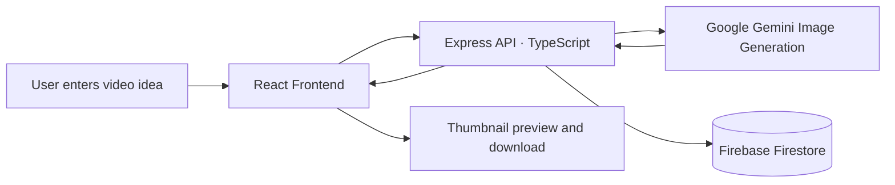
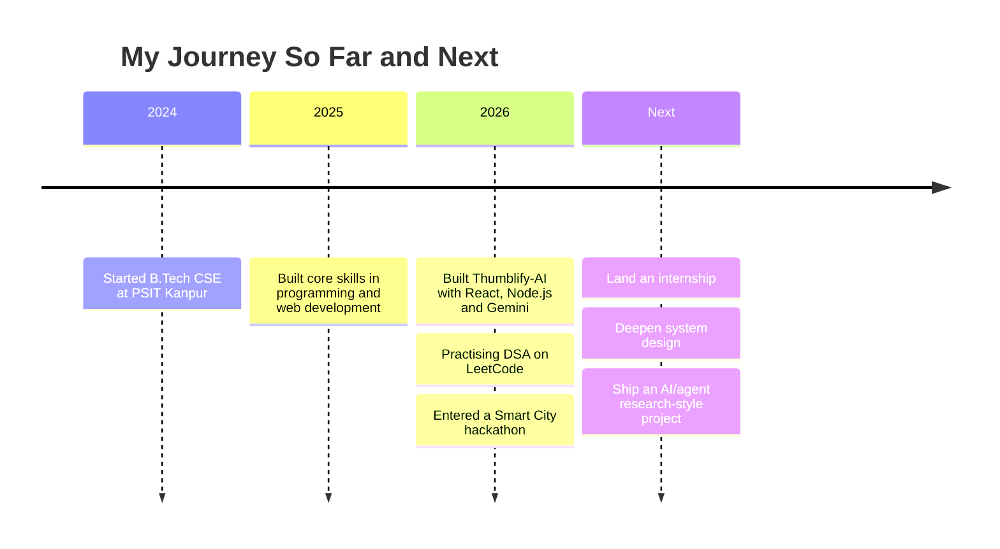

<!-- ================= HEADER ================= -->
<div align="center">


<a href="https://git.io/typing-svg">
  
</a>

<br/>

[](https://www.linkedin.com/in/YOUR-LINKEDIN-ID)
[](mailto:YOUR-EMAIL@example.com)
[](https://leetcode.com/u/YOUR-LEETCODE-ID)
[](https://YOUR-PORTFOLIO-LINK)


</div>


## 👋 About Me

I am a third-year Computer Science student in **Kanpur, India**, who enjoys turning ideas into working products. I build full-stack web applications, experiment with generative AI, and practise data structures and algorithms to keep my problem-solving sharp.

```js
const ayush = {
  name: "Ayush Dubey",
  education: "B.Tech CSE (2024 - 2028), PSIT Kanpur",
  focus: ["Full-Stack Development", "Generative AI", "DSA"],
  currentlyLearning: ["System Design", "LLM Applications"],
  lookingFor: "Software / AI-ML internships",
  funFact: "I generate YouTube thumbnails with AI, then wonder why I'm not a YouTuber.",
  motto: "Let's build."
};
```

<details>
<summary><b>🔎 Quick facts (click to expand)</b></summary>
<br/>

| | |
|---|---|
| 🎓 **Studying** | Computer Science & Engineering, 3rd year |
| 📍 **Based in** | Kanpur, Uttar Pradesh, India |
| 🌱 **Learning** | System design, LLM-powered applications |
| 💬 **Ask me about** | React, Node.js, Gemini API, LeetCode patterns |
| ⚡ **Looking for** | Internships in software development and AI/ML |

</details>

---

## 🛠️ Tech Stack

<table align="center">
  <tr>
    <td align="center" width="150"><b>Languages</b></td>
    <td></td>
  </tr>
  <tr>
    <td align="center"><b>Frontend</b></td>
    <td></td>
  </tr>
  <tr>
    <td align="center"><b>Backend</b></td>
    <td></td>
  </tr>
  <tr>
    <td align="center"><b>Database &amp; Cloud</b></td>
    <td></td>
  </tr>
  <tr>
    <td align="center"><b>AI &amp; Data</b></td>
    <td> </td>
  </tr>
  <tr>
    <td align="center"><b>Tools</b></td>
    <td></td>
  </tr>
</table>

---

## 🚀 Featured Projects

<div align="center">

<a href="https://github.com/ayush91dubey/Thumblify-AI">
  
</a>
<a href="https://github.com/ayush91dubey/Ayush-dubey-leetcode-practice-problems">
  
</a>

</div>

<details open>
<summary><b>🧠 Thumblify-AI: how it works</b></summary>
<br/>

AI-powered thumbnail generator that creates eye-catching YouTube thumbnails using Google Gemini image generation.



`React` `Node.js` `Express` `TypeScript` `Firebase Firestore` `Gemini API`

</details>

<details>
<summary><b>🧩 LeetCode Practice Problems</b></summary>
<br/>

A growing collection of my solutions to LeetCode problems, written to be clear and readable.

`Data Structures` `Algorithms` `Problem Solving`

</details>

<!-- Add a third project here, for example your Jammu Smart City Hackathon idea once it has a repo or write-up -->

---

## 🧭 Learning Roadmap



---

## 📊 GitHub Analytics

<div align="center">


<br/>


<br/>


<br/>


</div>

---

## 🌌 3D Contribution Graph

<div align="center">


</div>

---

## 🐍 Contribution Snake

<div align="center">

<picture>
  <source media="(prefers-color-scheme: dark)" srcset="https://raw.githubusercontent.com/ayush91dubey/ayush91dubey/output/github-snake-dark.svg" />
  <source media="(prefers-color-scheme: light)" srcset="https://raw.githubusercontent.com/ayush91dubey/ayush91dubey/output/github-snake.svg" />
  
</picture>

</div>

---

## 🎯 Current Focus

| Goal | Focus area |
|:--|:--|
| 🏗️ **Build** | Full-stack projects with clean code and good documentation |
| 🧮 **Practise** | DSA and problem-solving through consistent daily practice |
| 🤖 **Explore** | Applied AI: LLM-powered tools and agent-based systems |
| 🏆 **Compete** | Hackathons and open challenges |

---

## 💡 Dev Quote of the Day

<div align="center">


</div>

---

## 🤝 Let's Connect

I am open to internships, collaborations, and hackathon teams. If you are hiring or building something interesting, I would love to hear from you.

<div align="center">

[](https://www.linkedin.com/in/YOUR-LINKEDIN-ID)
[](mailto:YOUR-EMAIL@example.com)
[](https://leetcode.com/u/YOUR-LEETCODE-ID)


</div>
